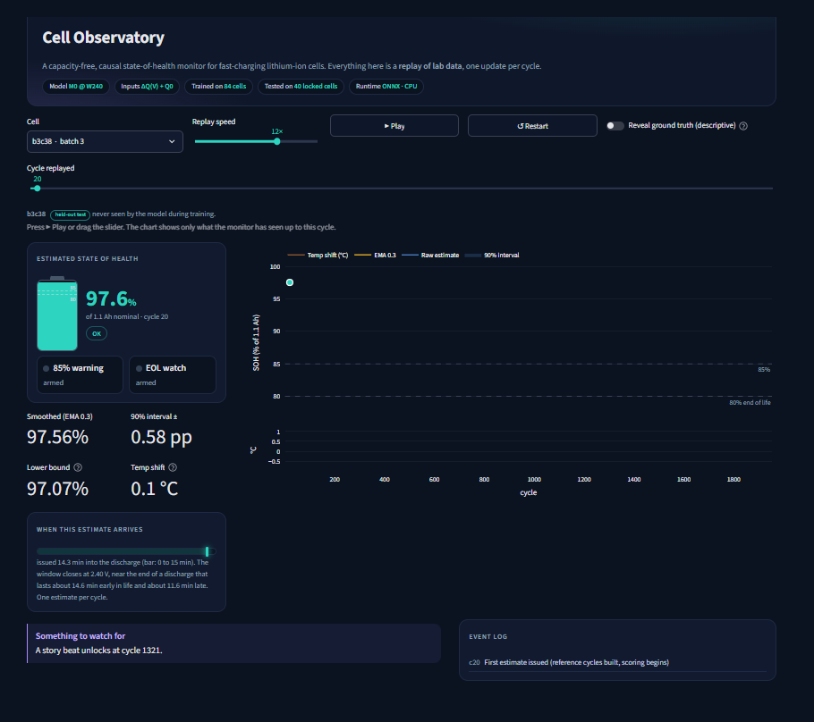
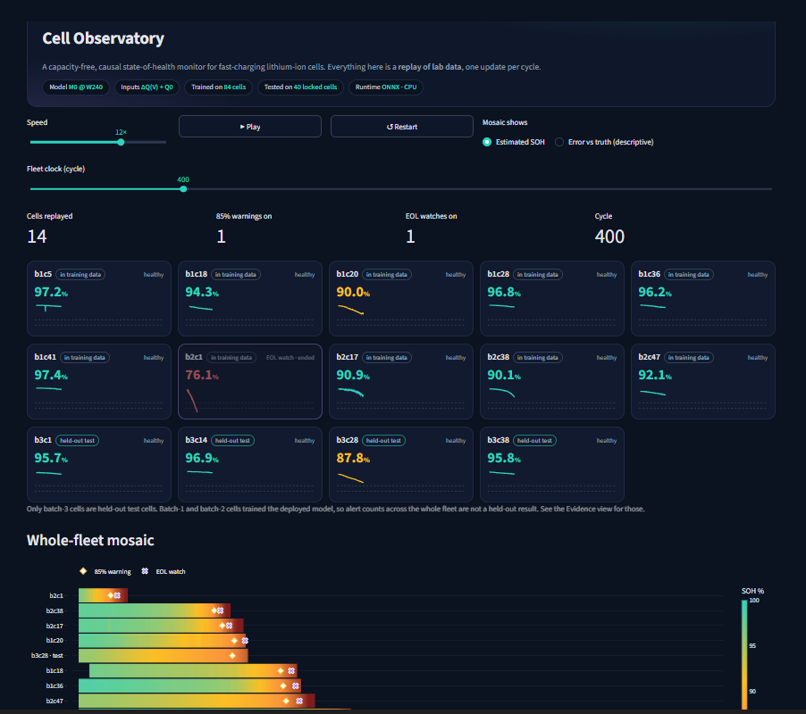
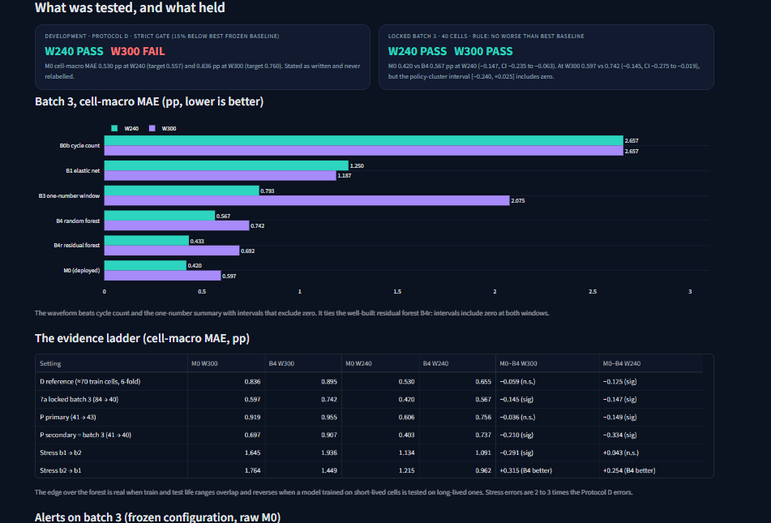
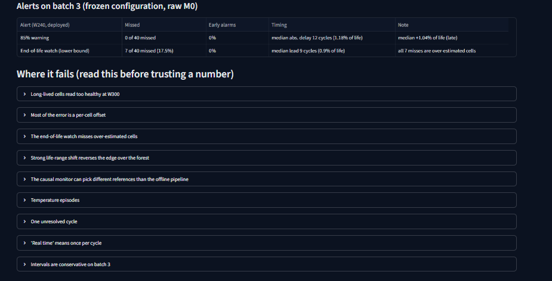
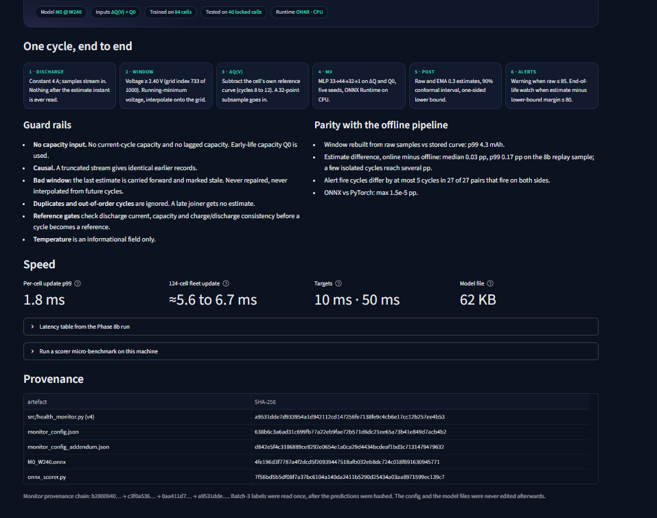

<h1 align="center">Battery Health Estimation</h1>

<p align="center">
  <strong>Capacity-free, causal State-of-Health estimation from partial-discharge curves.</strong><br />
  From MATR laboratory cycles to a compact ONNX model and a cycle-by-cycle monitoring dashboard.
</p>

<p align="center">
  <a href="https://github.com/Harjotsingh0311"></a>
  
  
  
  
  
</p>

<p align="center">
  
</p>

<p align="center"><em>Cell Observatory · single-cell replay · M0 at the W240 window</em></p>

---

## The project in one minute

This project investigates whether a lithium-ion cell's **partial discharge-voltage curve** contains enough information to estimate its State of Health (SOH) before the full discharge is complete—without using the current cycle's discharge capacity, charge capacity, or lagged capacity as model inputs.

The model learns a cell-relative signal, **ΔQ(V)**, referenced to that cell's own early-life discharge curve. A small neural network is trained from scratch, exported to ONNX, and served through a causal Python monitor. A Streamlit dashboard replays laboratory episodes one cycle at a time so that estimates, uncertainty intervals, and alerts can be inspected.

> **Important framing:** this is a replay of controlled laboratory data, not a live vehicle/BMS deployment. “Real time” means one update per cycle—not continuous, millisecond-level prediction throughout a discharge.

## At a glance

| | Project facts |
|---|---|
| Dataset | MATR lithium-ion fast-charging dataset · [source](https://data.matr.io/1/) |
| Curated cohort | 124 cells: 41 from batch 1, 43 from batch 2, and 40 from batch 3 |
| Evaluation design | 84 development cells; 40-cell batch-3 locked test |
| Primary deployed model | M0 · five-seed ensemble · 2,969 parameters per seed |
| Inputs | 32-point partial-discharge ΔQ(V) window + early-life reference capacity Q0 |
| Selected runtime window | W240, closing at 2.40 V |
| Batch-3 W240 cell-macro MAE | **0.420 percentage points (pp)** |
| Full per-cycle monitor latency | **0.46 ms median; about 1.8 ms p99** in the pinned CPU benchmark |
| Export | ONNX Runtime on CPU · approximately 62 KB model file |

*MAE is reported in percentage points of nominal SOH; lower is better. The results and limitations below explain which comparisons passed and which did not.*

## Dashboard preview

The dashboard is called **Cell Observatory**. It is designed as a replay console rather than a static metrics page: the operator can move the replay clock, inspect individual cells, compare the fleet, and open the evidence behind the model claims.

<table>
  <tr>
    <td width="50%">
      
      <p align="center"><strong>01 · Fleet wall</strong><br /><sub>Cell cards, replay clock, alert counts and fleet mosaic</sub></p>
    </td>
    <td width="50%">
      
      <p align="center"><strong>02 · Evidence</strong><br /><sub>Development and locked-test results, baseline comparisons and confidence intervals</sub></p>
    </td>
  </tr>
  <tr>
    <td width="50%">
      
      <p align="center"><strong>03 · Alerts and failure analysis</strong><br /><sub>Warning performance and known failure modes</sub></p>
    </td>
    <td width="50%">
      
      <p align="center"><strong>04 · Under the hood</strong><br /><sub>Causal guard rails, offline parity, latency and artifact provenance</sub></p>
    </td>
  </tr>
</table>

## How it works

```mermaid
flowchart TD
    A[Raw MATR MATLAB v7.3 / HDF5 files] --> B[Extraction, cell stitching and data-quality checks]
    B --> C[Cell-specific early reference curve and Q0]
    C --> D[Partial-discharge ΔQ(V) window · 32 sampled points]
    D --> E[M0 five-seed MLP · trained from scratch]
    E --> F[ONNX export · CPU inference]
    F --> G[Causal HealthMonitor]
    G --> H[Per-cycle SOH, interval and alert state]
    H --> I[Streamlit Cell Observatory replay dashboard]
```

### 1. Dataset preparation

The source files are MATLAB 7.3/HDF5 files and are read with `h5py`. The original inventory contains 140 cells. After applying the documented exclusions and stitching five batch-1/batch-2 continuation pairs, the main cohort contains **124 cells**:

| Cohort | Cells | Role |
|---|---:|---|
| Batch 1 | 41 | Development |
| Batch 2 | 43 | Development |
| Batch 3 | 40 | Locked final evaluation |
| **Total** | **124** | **84 development + 40 locked test** |

Data cleaning is explicit: placeholders, invalid windows, suspicious labels, and reference-cycle candidates are flagged rather than silently repaired. A causal serving path carries forward the last valid estimate and marks it stale when the current window is unusable.

### 2. Causal input and label

The offline training label is nominal SOH:

\[
\mathrm{SOH}_{nom}(k) = \frac{Q_D(k)}{1.1\ \mathrm{Ah}} \times 100\%
\]

At inference time, the monitor does **not** use the current cycle's `QD`, `QC`, or a lagged capacity value. Instead, it uses:

- **ΔQ(V):** the current partial-discharge curve relative to the cell's own early reference curve.
- **Q0:** the cell's early-life reference capacity, used to anchor the relative signal.

The selected input is a 32-point sample of the chosen voltage window plus Q0. Reference selection follows causal quality gates; the normal reference region is cycles 8–12, with a documented fallback for cells whose candidate reference cycles are flagged.

### 3. Model and serving

The deployed model is **M0**, a compact multilayer perceptron:

```text
33 inputs  →  44  →  32  →  1 output
              ReLU    ReLU
```

- 32 ΔQ(V) values + 1 Q0 value.
- 2,969 trainable parameters per seed.
- Five independently trained seeds; the ensemble mean is served.
- Trained from scratch—**no pre-trained model or pre-trained weights**.
- Exported to ONNX and executed with ONNX Runtime on CPU.

The dashboard defaults to M0 at **W240**. The M0+index variant remains available as an experimental comparison; it is not the default because cycle-index shortcuts showed mixed behaviour under life-range shift.

## Evaluation: what passed, and what did not

The project uses policy-aware validation because cells can share charge protocols. The 84 development cells use nested, policy-grouped validation. Batch 3 remains locked until the final model and configuration are frozen.

### Development results · Protocol D

The development gate required at least a 15% improvement over the frozen B4 random-forest baseline, along with a paired 95% cell-bootstrap interval below zero.

| Window | M0 cell-macro MAE | Frozen B4 MAE | 15% target | Verdict |
|---|---:|---:|---:|---|
| W300 · closes at 3.00 V | 0.836 pp | 0.895 pp | 0.760 pp | **FAIL** |
| W240 · closes at 2.40 V | **0.530 pp** | 0.655 pp | 0.557 pp | **PASS** |

At W300, M0's paired difference versus B4 was −0.059 pp (95% CI: −0.157 to +0.032), so the interval did not exclude zero and the 15% target was missed. At W240, the difference was −0.125 pp (95% CI: −0.207 to −0.049), satisfying the pre-registered gate. The W300 result is retained as a failure; the window was not changed after seeing the scores.

### Locked batch-3 results · 40 unseen cells

The batch-3 rule was the pre-registered “no worse than the best frozen baseline” comparison. These are the official cell-level results:

| Window | M0 MAE | Frozen B4 MAE | M0 − B4 · paired 95% CI | Cell-level verdict |
|---|---:|---:|---:|---|
| W300 · 3.00 V | **0.597 pp** | 0.742 pp | −0.145 [−0.275, −0.019] | **PASS** |
| W240 · 2.40 V | **0.420 pp** | 0.567 pp | −0.147 [−0.235, −0.063] | **PASS** |

**Policy-cluster qualification:** batch 3 contains eight policy groups. The policy-cluster interval for W300 is [−0.240, +0.025] pp and includes zero; W240 remains below zero at [−0.236, −0.052] pp. Therefore, W300 is a pass under the pre-registered cell-level rule but is less conclusive when policy clustering is accounted for. W240 holds under both checks.

### What the model can—and cannot—claim

- The waveform adds useful information beyond cycle count and the one-number window-capacity baseline on the development and batch-3 evaluations.
- M0 beats the frozen B4 baseline at W240 on development data and at both windows on the batch-3 cell-level comparison.
- M0 does **not** establish superiority over the stronger residual random forest B4r. The paired intervals include zero at both batch-3 windows; the accurate conclusion is that M0 is statistically tied with that comparator.
- The results do not establish transfer to variable-current vehicle operation. The source data use a controlled laboratory discharge protocol.

## Monitoring behaviour and engineering checks

The online monitor applies causal checks before accepting a cycle. It rejects malformed or implausible windows, ignores duplicate/out-of-order cycles, handles late-joining cells without a reference, and carries forward stale estimates rather than repairing them with future data.

| Engineering check | Measured result |
|---|---:|
| ONNX Runtime per-cell cycle update | 0.455–0.477 ms median across three passes |
| Per-cell cycle update, p99 | 1.788–1.830 ms |
| 124-cell fleet update, median | 5.57–6.71 ms |
| Model artifact | Approximately 62 KB |
| Online/offline estimate difference | Approximately 0.03 pp median; p99 about 0.17 pp excluding the exceptional b1c18 reference case |

The dashboard's W240 alert evaluation on the 40 batch-3 cells reported:

- **85% warning:** 0 of 40 missed; no early alarms; median absolute delay of about 12 cycles (1.18% of cell life).
- **80% end-of-life watch:** 7 of 40 missed (17.5%). This is a known limitation and should not be treated as a dependable stand-alone end-of-life safety trigger.

The 90% conformal intervals are calibrated using development data. On batch 3 at W240, observed coverage was 0.980 with a mean interval width of 2.65 pp; the intervals are conservative rather than especially tight.

## Known limitations

This project is a research prototype. The following constraints matter when interpreting its numbers:

1. **Laboratory replay, not live deployment.** The monitor replays recorded lab cycles. It is not connected to a live battery-management system.
2. **One estimate per cycle.** The W240 estimate arrives about 12.8–13.6 minutes into a discharge. It is near the end of a roughly 14.6-minute discharge early in life and about 11.6 minutes late in life—not an instantaneous early-cycle estimate.
3. **End-of-life alert misses.** The W240 80% watch missed 7/40 batch-3 cells. The 85% warning performed better, but neither output is safety-certified.
4. **Long-life over-estimation at W300.** Error increases for the longest-lived cells; late-life SOH can be over-estimated, which is the unsafe direction for an end-of-life alert. W240 reduces this trend but does not make the model universally reliable.
5. **Domain shift.** The dataset uses a fixed laboratory discharge current. Performance under dynamic EV loads, different chemistries, temperatures, hardware, or field conditions has not been established.
6. **Dashboard interaction testing.** The Streamlit test runner passed on schema-matched synthetic fixtures, and the screenshots here show the real replay views. Browser-level autoplay, reveal-truth mode, and the optional micro-benchmark interaction have not been fully audited.

Do not use these estimates as the sole basis for battery protection, warranty, or safety decisions.

## Run the dashboard locally

The dashboard is a Streamlit app. From the repository root, activate the project's configured `uv` environment and run:

```bash
uv run streamlit run dashboard/app.py
```

Then open the local Streamlit URL printed in the terminal (normally `http://localhost:8501`).

### Required local artifacts

The raw MATR files and processed datasets are intentionally kept out of Git. The dashboard also depends on the frozen replay and model artifacts produced by the earlier project phases. Before launching from a fresh clone, make sure the corresponding files are available locally:

- The frozen replay Parquet files under `outputs/phase8b/replay/`.
- The exported ONNX model files under `outputs/phase8a/models/`.
- The matching frozen monitor configuration and source modules under `outputs/` and `src/`.

The dashboard is a viewer/replayer of these frozen artifacts; it does not retrain the model or regenerate the evaluation. A fresh clone without these artifacts will not reproduce the screenshots by itself.

## Repository layout

```text
Battery-Health-Estimation/
├── .streamlit/                 # Streamlit theme/configuration
├── dashboard/
│   └── app.py                  # Cell Observatory dashboard
├── data/
│   ├── raw/                    # Local MATR source files (not committed)
│   └── processed/              # Local derived data (not committed)
├── notebooks/                  # Phase-wise experiments and analysis
├── outputs/                    # Reports and frozen runtime/evaluation artifacts
├── src/
│   ├── health_monitor.py       # Causal per-cell streaming monitor
│   └── onnx_scorer.py          # ONNX Runtime inference wrapper
├── assets/
│   └── screenshots/            # README dashboard screenshots
├── .gitignore
└── README.md
```

## Dataset and reproducibility

The project uses the [MATR dataset](https://data.matr.io/1/). Download and use the dataset under its applicable terms; the raw files are not redistributed in this repository. The analysis records source-file hashes and phase-specific artifact hashes so that frozen inputs, configurations, model files, and evaluation outputs can be checked for accidental changes.

The batch-3 test is considered spent: its labels must not be used to choose a model, voltage window, calibration, threshold, or other deployment setting. The reported batch-3 figures are evaluation results, not tuning feedback.

## Built by

**Harjot Singh** · [@Harjotsingh0311](https://github.com/Harjotsingh0311)

*Battery SOH Estimation · 2026 · Research prototype*

---

<p align="center"><sub>Built around one principle: an estimate is only useful when its inputs, timing, validation and failure modes are made explicit.</sub></p>
